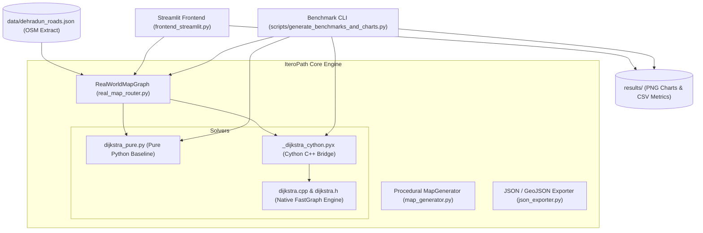

# IteroPath Architecture & Data Flow

This document outlines the software architecture, modular structure, and execution flow of **IteroPath**.

---

## 1. System Architecture



---

## 2. Module Directory Structure

```text
dijkstra-fast-cpp/
├── dijkstra_fast_cpp/                  # Core Python/Cython package
│   ├── data/
│   │   └── dehradun_roads.json        # 19,765 nodes, 37,399 road edges (Greater Dehradun)
│   ├── dijkstra.h                      # C++ FastGraph header declaration
│   ├── dijkstra.cpp                    # C++ FastGraph implementation (std::priority_queue)
│   ├── c_dijkstra.pxd                  # Cython C++ extern declaration
│   ├── _dijkstra_cython.pyx            # Cython extension module
│   ├── dijkstra_pure.py                # Pure Python Dijkstra baseline
│   ├── real_map_router.py              # OpenStreetMap parser, KD-snapper, turn-by-turn logic
│   ├── map_generator.py                # Synthetic procedural line-intersection generator
│   └── json_exporter.py                # Standardized JSON export formatter
├── docs/                               # Comprehensive Technical Documentation
│   ├── algorithm.md                    # Algorithmic foundations and complexity analysis
│   ├── architecture.md                 # System architecture and data-flow specifications
│   └── results.md                      # Verified empirical benchmarks and latency tables
├── results/                            # Benchmark artifacts and high-resolution charts
│   ├── benchmark_results.csv           # Scalability data (V = 1k to 50k)
│   ├── route_results.csv               # Real Dehradun corridor benchmarks
│   ├── execution_time.png              # Logarithmic latency comparison plot
│   ├── speedup.png                     # Speedup multipliers across graphs and waypoints
│   ├── overall_performance.png         # 4-panel executive dashboard
│   ├── route_comparison.png            # Corridor bar chart (UPES to Raipur Road)
│   └── synthetic_scaling.png           # Complexity curve vs theoretical bounds
├── scripts/
│   └── generate_benchmarks_and_charts.py # Automated benchmark & plot generator
├── tests/
│   └── test_dijkstra.py                # Automated pytest unit test suite
├── frontend_streamlit.py               # Interactive web navigation dashboard
├── frontend_gui.py                     # Standalone desktop Tkinter GUI
├── setup.py                            # C++ compilation configuration
├── pyproject.toml                      # Build toolchain & package metadata
└── README.md                           # GitHub landing page & showcase
```

---

## 3. Data Flow

1. **Network Initialization**:
   - `RealWorldMapGraph` parses OpenStreetMap node coordinates and road ways.
   - Cleans raw highway classifications into clear street names (`Bidholi Connector Road`, `Pondha-Bidholi Road`, `Chakrata Main Road`).
   - Populates contiguous edge structures into `FastGraph` in native C++.

2. **Waypoint Snapping**:
   - Landmark coordinates (or user map clicks) are snapped to the nearest road network intersection node using Haversine distance calculations.

3. **Dual Execution & Verification**:
   - When requested, both pure Python and Cython C++ execute the query.
   - Run latencies are timed with nanosecond resolution via `time.perf_counter()`.
   - The path distances and reachability flags are verified for exact numerical equality ($\Delta = 0.000000000\text{ m}$).

4. **Turn-by-Turn Synthesis**:
   - Edge bearings (North, South-East, etc.) and named street segments are synthesized into readable human-facing driving instructions.

5. **Visualization & Export**:
   - Streamlit renders the paths on interactive Leaflet maps with color-coded corridors.
   - Complete route coordinates, checkpoints, instructions, and benchmark metrics can be exported in one click as structured JSON.
