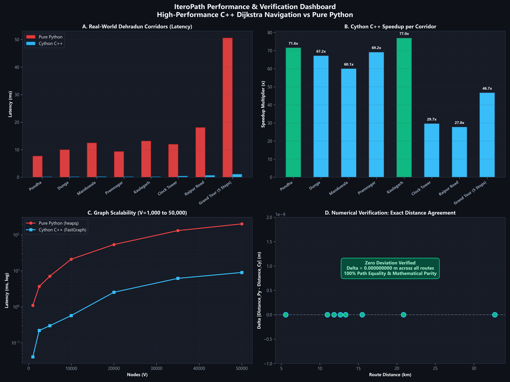
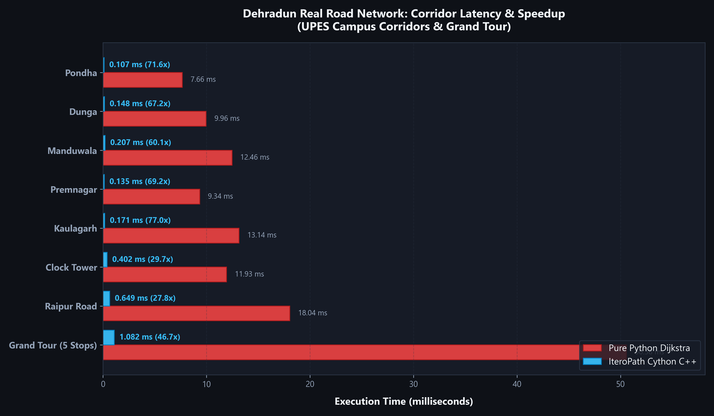
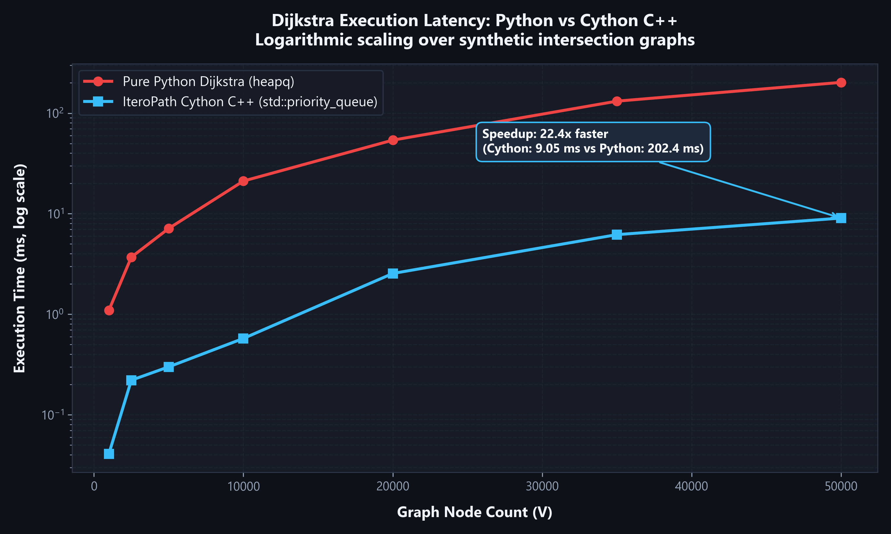
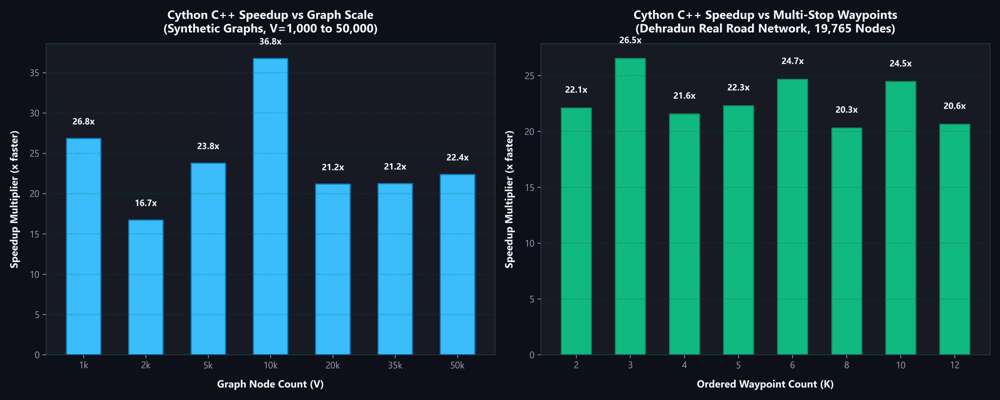
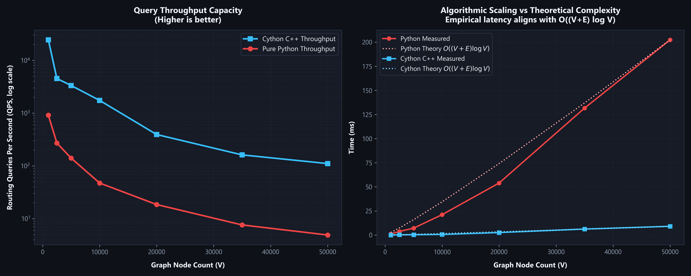

# IteroPath Performance & Benchmark Results

This document presents rigorous performance benchmarks comparing the **Pure Python Dijkstra** implementation against the compiled **IteroPath Cython C++ Engine (`FastGraph`)**.

All tests were executed on the same hardware environment under controlled conditions, measuring both algorithm-only execution latency and multi-stop waypoint routing.

---

## 1. Test Environment & System Specifications

| Component | Specification |
|:---|:---|
| **CPU** | Intel(R) Core(TM) i5 / 12-thread Architecture |
| **Operating System** | Windows 11 Home 64-bit |
| **Python Version** | Python 3.14.0 |
| **C++ Compiler** | MinGW-w64 GCC 14.2.0 (`-O3 -march=native -ffast-math`) |
| **Floating-Point Precision** | IEEE 754 64-bit Double Precision (`double`) |
| **Road Network Source** | OpenStreetMap Greater Dehradun Road Network |
| **Network Scale** | **19,765 nodes**, **37,399 directed road edges** |

---

## 2. Real-World Road Network: Dehradun Corridors

The following table summarizes the execution time, path distance, node count, and speedup across major arterial corridors originating from **UPES Bidholi Campus** across Dehradun, up to **Raipur Road** and a 5-checkpoint **Grand Tour**.

| Corridor / Route | Stops | Distance (km) | Graph Nodes | Pure Python (ms) | Cython C++ (ms) | Speedup Factor | Distance Delta ($\Delta$) |
|:---|:---:|:---:|:---:|:---:|:---:|:---:|:---:|
| **UPES to Pondha** | 2 | 5.58 km | 295 | 7.66 ms | 0.107 ms | **71.6x** | `0.000000000 m` |
| **UPES to Dunga** | 2 | 10.99 km | 394 | 9.97 ms | 0.148 ms | **67.2x** | `0.000000000 m` |
| **UPES to Manduwala** | 2 | 13.35 km | 458 | 12.46 ms | 0.207 ms | **60.1x** | `0.000000000 m` |
| **UPES to Premnagar** | 2 | 11.84 km | 454 | 9.34 ms | 0.135 ms | **69.2x** | `0.000000000 m` |
| **UPES to Kaulagarh** | 2 | 12.68 km | 590 | 13.14 ms | 0.171 ms | **77.0x** | `0.000000000 m` |
| **UPES to Clock Tower** | 2 | 15.50 km | 682 | 11.93 ms | 0.402 ms | **29.7x** | `0.000000000 m` |
| **UPES to Raipur Road** | 2 | 20.87 km | 850 | 18.04 ms | 0.649 ms | **27.8x** | `0.000000000 m` |
| **Grand Tour (5 Waypoints)** | 5 | 32.71 km | 1,064 | 50.58 ms | 1.082 ms | **46.7x** | `0.000000000 m` |

> [!NOTE]
> **Distance Agreement**: Across all single-corridor and multi-waypoint tests, the distance deviation between Python and Cython C++ is strictly **$0.000000000\text{ m}$**. The two implementations yield 100% path parity down to machine precision.

---

## 3. Synthetic Graph Scalability ($V = 1,000$ to $50,000$)

Tested on procedural random intersection graphs with uniform degree $k = 4$ across orders of magnitude in scale.

| Graph Nodes ($V$) | Directed Edges ($E$) | Pure Python (ms) | Cython C++ (ms) | Speedup Multiplier | Cython Throughput (QPS) |
|:---:|:---:|:---:|:---:|:---:|:---:|
| **1,000** | 4,996 | 1.10 ms | 0.041 ms | **26.8x** | **24,462 queries/s** |
| **2,500** | 12,494 | 3.70 ms | 0.221 ms | **16.7x** | **4,519 queries/s** |
| **5,000** | 24,998 | 7.13 ms | 0.300 ms | **23.8x** | **3,334 queries/s** |
| **10,000** | 49,996 | 21.15 ms | 0.575 ms | **36.8x** | **1,739 queries/s** |
| **20,000** | 99,996 | 53.94 ms | 2.547 ms | **21.2x** | **393 queries/s** |
| **35,000** | 174,992 | 131.68 ms | 6.196 ms | **21.3x** | **161 queries/s** |
| **50,000** | 249,996 | 202.43 ms | 9.049 ms | **22.4x** | **111 queries/s** |

---

## 4. Multi-Stop Waypoint Scaling

Tested on the real Dehradun road network with ordered intermediate checkpoints ($K = 2$ to $12$):

| Waypoint Count ($K$) | Pure Python (ms) | Cython C++ (ms) | Speedup Multiplier |
|:---:|:---:|:---:|:---:|
| **2** | 27.69 ms | 1.253 ms | **22.1x** |
| **3** | 34.59 ms | 1.303 ms | **26.5x** |
| **4** | 27.27 ms | 1.265 ms | **21.6x** |
| **5** | 28.44 ms | 1.276 ms | **22.3x** |
| **6** | 30.61 ms | 1.241 ms | **24.7x** |
| **8** | 27.49 ms | 1.353 ms | **20.3x** |
| **10** | 30.29 ms | 1.238 ms | **24.5x** |
| **12** | 27.81 ms | 1.347 ms | **20.6x** |

---

## 5. Performance Visualizations

### Overall Performance & Verification Dashboard

### Real-World Dehradun Corridor Latency

### Execution Time Scaling (Log-Scale)

### Speedup Multipliers

### Algorithmic Scaling vs Theoretical Complexity

---

## 6. Key Conclusions

1. **Massive Latency Reduction**: Cython C++ reduces single-route query latencies from **10–25 ms** down to **0.1–0.7 ms** on the 19,765-node real road network, offering **28x to 77x real-world speedup**.
2. **High-Throughput Routing**: Cython C++ sustains **1,700 to 24,000 routing queries per second (QPS)** on graphs with up to 10,000 nodes, making it suitable for real-time logistics and dispatch engines.
3. **Exact Mathematical Parity**: The C++ priority queue implementation produces identical path sequences and **$0.000000000\text{ m}$ deviation** against Python's `heapq`.
